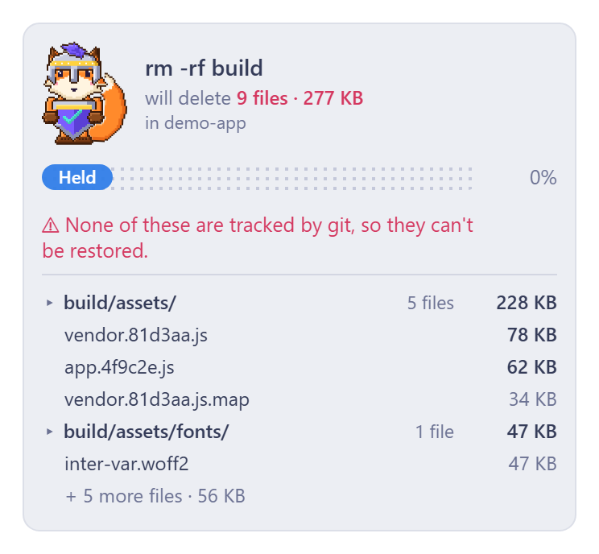
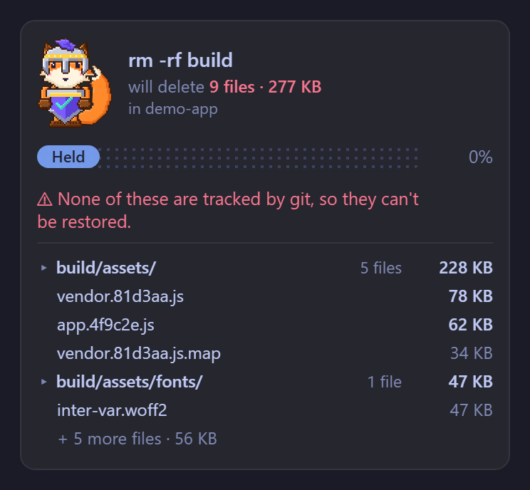
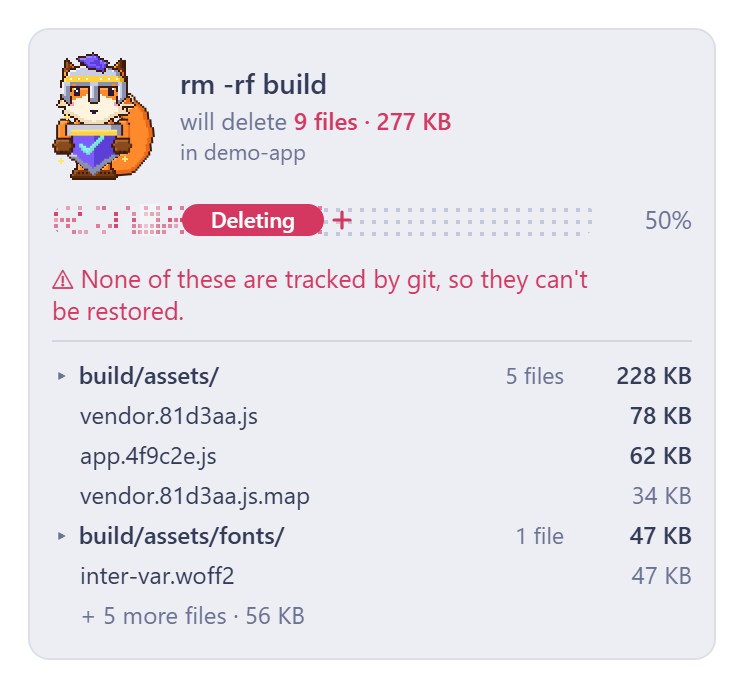
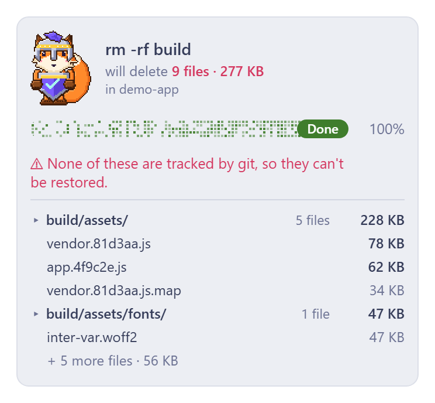

# Foxel rmShield

A Claude Code mod that **holds a risky shell command** and shows you what it would change before it runs. Foxel stands guard with a shield while the command is held; you press **Delete** (run it) or **Cancel** (refuse it). Claude sees the refusal and the reason.

| Held | Held (dark) |
| --- | --- |
|  |  |

| Running | Done |
| --- | --- |
|  |  |

The images show the card the mod draws. The **Delete N files** and **Cancel** buttons are native Claude Code buttons shown right under it and are not part of the images. The progress bar is an animation that marks the phases (Held, Deleting, Done); it does not count deleted files.

## What it holds

When Claude calls the **Bash** tool with one of these, the call is stopped, measured, and shown:

| Command | What the card shows |
| --- | --- |
| `rm -r`, `rm -R`, `rm -f`, `rm -rf` (also `--recursive`, `--force`, `-fr`) | The files it would delete, grouped by folder, with counts and sizes, and how many are tracked by git. Globs and `~` are expanded. |
| `git reset --hard` | The files with uncommitted changes. |
| `git checkout -- .`, `git restore .` | The files with unstaged changes. |
| `git clean` | The untracked paths it would remove (from `git clean -n`). |
| `git push --force`, `-f`, `+ref`, `--force-with-lease` | The remote commits your HEAD does not have, which the push would drop. |
| `manage.py migrate`, `db:migrate`, `alembic upgrade`, `prisma migrate` | The pending migrations, from the tool's own status command. |
| any other `migrate` | A note that the pending migrations cannot be listed. |

It sees through `sudo`, `env`, `command`, `exec`, `nohup`, `time`, `nice`, `\rm`, `/bin/rm`, `cd dir &&`, `git -C dir`, chains (`&&`, `;`, `|`, `||`), subshells, braces and `if`/`while`/`for`. Every other command runs as normal.

## What it does not hold

Be aware of the gaps; this is a safety net, not a sandbox.

- It only hooks the **Bash** tool. Commands sent through the **PowerShell** tool are not held.
- Not recognised: `rm.exe`, `cmd /c`, `powershell -c`, `git push -uf`, pushes that delete a branch (`:branch`, `--delete`), `--mirror`, `git checkout -f`, `git switch -f`, `git checkout -- <path>`, `git restore <path>`.
- Commands hidden inside other commands are not unwrapped: `$( )`, backticks, `bash -c`, `eval`, `xargs rm`, `find -delete`.
- When the target uses shell expansion (`$VAR`, `{a,b}`) the card says it cannot measure it; the command is still held.

## Behaviour you can rely on

- **Fails closed.** If the mod hits an internal error before the command runs, the command is refused, never run unguarded. After the command has run it is never run a second time.
- **Cancel has focus**, so pressing Enter refuses the command.
- A held command that gets no answer for **10 minutes** is refused.
- Measuring is read-only: bash with the paths passed as arguments (never as script text), read-only `git` commands, `sleep`, and, for migrations, the project's own status command. No network access, no file writes.
- The card follows the light or dark theme. In a plain terminal it falls back to a text pane.

## Requirements

- Claude Code with mods support (2.1.287 or later).
- Windows with **Git for Windows** in `C:\Program Files\Git`. The module starts `bash.exe` and `sleep.exe` by those full paths. On macOS or Linux, change `BASH_BIN` and `SLEEP_BIN` at the top of `foxel-rmshield/hooks/foxel-rmshield.mjs` to `"bash"` and `"sleep"`.

## Install

Check the plugin, then try it for one session:

```bash
claude plugin validate ./foxel-rmshield
claude --plugin-dir ./foxel-rmshield
```

Or add this repository as a local marketplace and install it:

```bash
claude plugin marketplace add ./
claude plugin install foxel-rmshield@foxel-rmshield --scope user
```

Restart Claude Code after installing or updating, because mods load at start. A good first check: ask Claude to run `rm -rf` on a throwaway folder; the Foxel rmShield card must appear. If the command runs with no card, the mod did not load.

## Files

| File | Purpose |
| --- | --- |
| `foxel-rmshield/.claude-plugin/plugin.json` | Plugin manifest |
| `foxel-rmshield/hooks/hooks.json` | Points to the module |
| `foxel-rmshield/hooks/foxel-rmshield.mjs` | The whole mod: classifier, measuring, card, phases |
| `.claude-plugin/marketplace.json` | Lets this repository act as a marketplace |

## License

Apache-2.0. Copyright 2026 Foxel. See [LICENSE](LICENSE).
